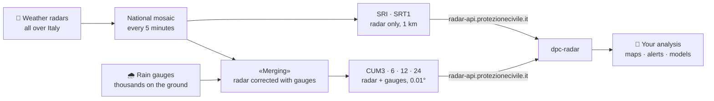
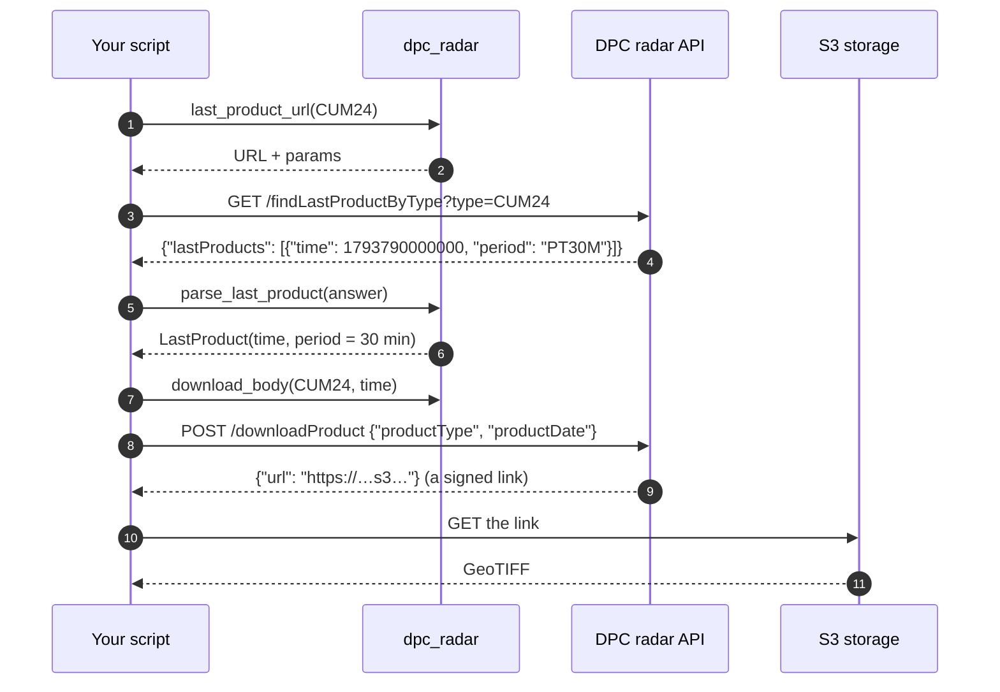
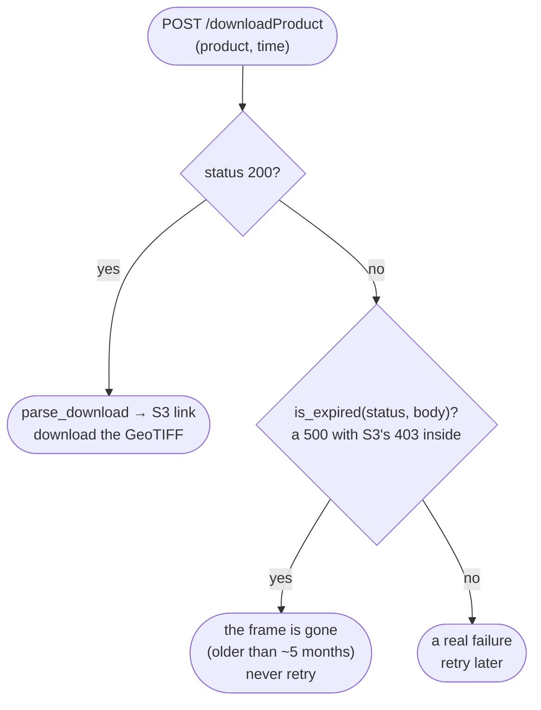
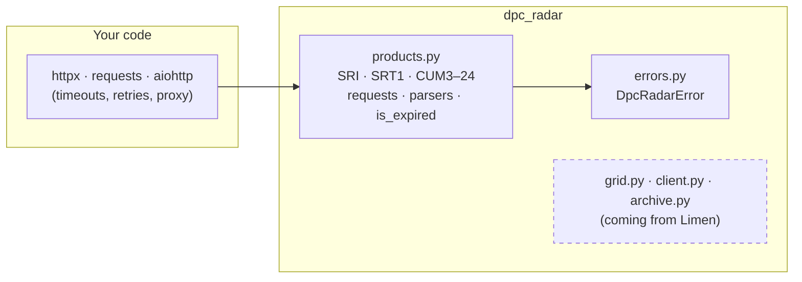
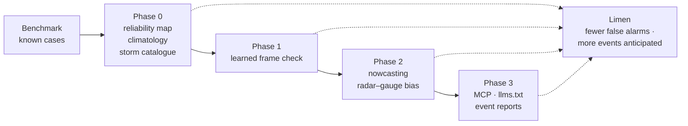

<p align="center">
  
</p>

<p align="center">
  <a href="https://github.com/agent-engineering-studio/dpc-radar/actions/workflows/ci.yml"></a>
  <a href="https://pypi.org/project/dpc-radar/"></a>
  <a href="https://agentengineering.it/dpc-radar/"></a>
  
  
  
  <a href="https://github.com/agent-engineering-studio/dpc-radar/blob/main/LICENSE"></a>
</p>

**dpc-radar** is a small, typed Python library for the open radar data of
the Italian **Civil Protection Department** (*Dipartimento della Protezione
Civile*, DPC). A national network of weather radars, together with
thousands of rain gauges, measures rain over all of Italy, and the DPC
publishes a new map **every 5 minutes**, free for anyone. This library lets
you use those maps from a script: which frame is the latest, how to download
it, and how to read the API's answers, including its surprises.

```python
from dpc_radar import CUM24, parse_last_product, products

url, params = products.last_product_url(CUM24)  # GET it, with products.HEADERS
latest = parse_last_product(answer)  # time and period of the newest frame
```

> **Work in progress.** dpc-radar is being extracted from
> [Limen](https://github.com/agent-engineering-studio/limen), where this code
> already runs in production. Today it holds the products and the API
> requests and answers. The rain grid, the client, the archive, the
> 2010–2025 history and the criticality bulletins follow, one pull request at
> a time: see the [roadmap](https://agentengineering.it/dpc-radar/roadmap/).
> Nothing is on PyPI yet.

---

## Contents

- [The radar of Italy, in 30 seconds](#the-radar-of-italy-in-30-seconds)
- [What a storm looks like](#what-a-storm-looks-like)
- [The products](#the-products)
- [Who is it for](#who-is-it-for)
- [Quick start](#quick-start)
- [How it works](#how-it-works)
- [The traps we already fell into](#the-traps-we-already-fell-into)
- [API at a glance](#api-at-a-glance)
- [Roadmap, and where AI helps](#roadmap-and-where-ai-helps)
- [Contributing](#contributing)
- [Data licence and credits](#data-licence-and-credits)

---

## The radar of Italy, in 30 seconds

A weather radar sends out a pulse of microwaves and listens for the echo.
Raindrops reflect it: the stronger the echo, the heavier the rain. The DPC
joins the radars that cover Italy into **one national map**, and then
corrects the radar with what the **rain gauges** on the ground really
collected. The correction is called the **«Merging»**.



What you can do with it, for example:

- know **how much it has rained** in a place in the last 3, 6, 12 or 24 hours;
- see a **storm arriving**, 5 minutes at a time;
- feed **flood and landslide models** with rain that was measured, not forecast;
- keep your own **archive**: the DPC keeps only about five months.

## What a storm looks like

On **10 October 2026** a storm hit the area around Reggio Calabria, in the
toe of Italy. This is the rain of those 24 hours, from one frame of the
«Merging» CUM24 product:

<p align="center">
  
</p>

The radar sees the storm **while it happens**. Here is the rain intensity
(SRI, in mm per hour) at four moments of the same day:

<p align="center">
  
</p>

> Look at the arcs west of Sardinia at 06:00. Rings centred on a single
> radar usually mean an artefact, not a storm: the radar picks up echoes from
> the sea or from bent beams. Check a frame against the one before it before
> you trust it ([the traps](#the-traps-we-already-fell-into)).

And this is the same storm in **one place**, hour by hour. At Melito di
Porto Salvo most of the rain fell before dawn, between midnight and 05:00
UTC, with up to **21 mm in a single hour**:

<p align="center">
  
</p>

Radar alone, or radar corrected with the gauges? At Melito the gauges
(«Merging») measured **185 mm** in the day, and the radar alone saw only
**115 mm**. Over the whole box, though, the radar read about **12 % more**
than the gauges. The radar is wrong in both directions, depending on the
place. That is why the «Merging» exists: it keeps the radar's picture and
corrects it to what the gauges collected.

<p align="center">
  
</p>

Zoom out, and five months of frames tell the story of a season. Averaged
over all of Italy's land, 10 October was not even the wettest day of the
autumn: 21 October was (19.4 mm on average against 7.1). A storm that
devastates one valley can be a small bar on a national chart.

<p align="center">
  
</p>

Every image above is made from real DPC frames by
[`docs/make_images.py`](https://github.com/agent-engineering-studio/dpc-radar/blob/main/docs/make_images.py),
with the functions of this library.

## The products

<p align="center">
  
</p>

| Product | What it measures | Source | Grid | New frame |
|---|---|---|---|---|
| `SRI` | rain intensity right now (mm/h) | radar only | 1 km | every 5 min |
| `SRT1` | rain in the last hour (mm) | radar only | 1 km | every 5 min |
| `CUM3`, `CUM6`, `CUM12`, `CUM24` | rain in the last 3–24 hours (mm) | «Merging»: radar + rain gauges | 0.01°, EPSG:4326 | every 30 min |

**Which one should I use?**

- *Is it raining now, and how hard?* → `SRI`.
- *How much rain fell in the last hour?* → `SRT1`.
- *How much rain fell in the last day?* → `CUM24` (or `CUM3`–`CUM12` for shorter windows). The gauges make it the most accurate, but it arrives every 30 minutes, not every 5.

## Who is it for

- **Researchers and students** in hydrology, meteorology and geology who
  want measured rain in a notebook or a pipeline.
- **Civil protection, utilities and engineers** who watch rivers, slopes,
  roads or drains and need rain totals that are repeatable.
- **Data journalists and developers** who want to show what fell during a
  storm, with a source anyone can check.

It started inside [Limen](https://github.com/agent-engineering-studio/limen),
where the radar decides *when* to re-run the risk model (heavy rain on the
radar starts a run at once) and the «Merging» totals feed the flood score.

---

## Quick start

### 1. Install

```bash
pip install dpc-radar   # not on PyPI yet: for now, install from git
pip install "dpc-radar @ git+https://github.com/agent-engineering-studio/dpc-radar"
```

Python 3.12 or newer. The core has **no dependencies**: it builds requests
and reads answers, and you send them with the HTTP library you like.

No account and no key: the DPC data are open.

### 2. Ask for the latest frame

```python
import httpx

from dpc_radar import CUM24, parse_last_product, products

url, params = products.last_product_url(CUM24)
answer = httpx.get(url, params=params, headers=products.HEADERS).json()

latest = parse_last_product(answer)
print(latest.time, latest.period)
# 2026-11-04 11:00:00+00:00 0:30:00   (a new CUM24 every 30 minutes)
```

### 3. Download it

```python
from dpc_radar import is_expired, parse_download

r = httpx.post(
    products.download_url(),
    json=products.download_body(CUM24, latest.time),
    headers=products.HEADERS,
)
if is_expired(r.status_code, r.text):
    print("the DPC no longer keeps this frame")  # never worth a retry
else:
    tiff = httpx.get(parse_download(r.json())).content  # a GeoTIFF, rain in mm
```

That's it: `tiff` is a GeoTIFF of 1,341 × 1,233 pixels (0.01° each) covering Italy,
with `-9999` where the radar does not see.

### 4. Look at it

With `pip install rasterio matplotlib`:

```python
import io

import matplotlib.pyplot as plt
import numpy as np
import rasterio

with rasterio.open(io.BytesIO(tiff)) as src:
    rain = src.read(1)
    w, s, e, n = src.bounds

rain = np.where(rain < 0, np.nan, rain)  # -9999: no data
plt.imshow(rain, extent=(w, e, s, n), cmap="Blues", vmin=0, vmax=50)
plt.colorbar(label="rain in the last 24 hours (mm)")
plt.show()
```

---

## How it works

### Two calls, and one surprise

The open API at `radar-api.protezionecivile.it` has two calls that matter.
The first says which frame is the newest; the second gives a short-lived
download link for one frame.



### What a frame request can answer



### The building blocks

The core is **pure**: no network, no files. It builds requests and reads
answers, so it is easy to test and works with any HTTP stack, sync or async.



---

## The traps we already fell into

Every line below cost a bug in Limen. The library handles the ones it can;
the others are here so you don't have to find them yourself.

| Trap | What happens | What to do |
|---|---|---|
| **No `CUM1`** | asking for it gives an empty list, not an error | the shortest «Merging» is `CUM3`; for one hour use `SRT1` |
| **"Gone" looks like a crash** | a frame older than ~5 months answers **500**, with S3's `403 Forbidden` in the body, not 404 | `is_expired(status, body)`: never retry those |
| **The «Merging» disappears** | the DPC keeps about five months, and there is no public archive of it | save the frames you need (the `archive` module is coming) |
| **Two grids** | `SRI`/`SRT1` are 1 km in a Transverse Mercator projection; `CUM*` are 0.01° in EPSG:4326 | never mix the arrays: reproject one onto the other |
| **One hot pixel** | Limen once read 7,348 mm from a single pixel | sample a place with the median of the 3×3 pixels around it, never one pixel |
| **Not every echo is rain** | sea clutter or a radar with a problem can paint rain where there is none, often as a disk around one radar | check a frame against the one before it before you use it |
| **Radar alone is not the truth** | the radar-only history read between 10 % and 80 % of the gauges in Apulia in 2016 | use the «Merging» when you can; compare on your area |
| **Times are in UTC, in milliseconds** | the API speaks epoch milliseconds | `to_epoch_ms` / `from_epoch_ms`, and always aware datetimes |
| **The `origin` header** | the API once refused requests without it; in November 2026 it no longer does | `products.HEADERS` sends it anyway |

---

## API at a glance

| Name | What it is |
|---|---|
| `SRI`, `SRT1`, `CUM3`, `CUM6`, `CUM12`, `CUM24` | the products: `name`, `hours` (`None` for an intensity), `merging`, `description` |
| `PRODUCTS`, `product(name)` | every product by name; `product("cum24")` → `CUM24` |
| `products.last_product_url(p)` | URL and params of the "latest frame" request (a `GET`) |
| `products.download_url()`, `products.download_body(p, at)` | URL and JSON body of the "download link" request (a `POST`) |
| `parse_last_product(answer)` | `LastProduct(product, time, period)`, or `None` if the API lists none |
| `parse_download(answer)` | the signed S3 link of a frame |
| `is_expired(status, body)` | `True` when the frame is gone for good |
| `products.HEADERS`, `products.NODATA` | the `origin` header; `-9999.0`, the no-data value of every product |
| `products.to_epoch_ms`, `from_epoch_ms`, `parse_period` | the API's times and periods (`PT5M`, `PT30M`) |
| `DpcRadarError` | an answer the library cannot read, or a bad argument |

Full reference: **https://agentengineering.it/dpc-radar/api/products/**

---

## Roadmap, and where AI helps

The plan is on the [roadmap](https://agentengineering.it/dpc-radar/roadmap/)
and tracked in [#10](https://github.com/agent-engineering-studio/dpc-radar/issues/10).
Each idea is measured against one goal of
[Limen](https://github.com/agent-engineering-studio/limen): anticipate within
72 hours 90 % of the events in the news, with at most 10 % of
municipality-days on alert.



| Idea | In plain words | What Limen gains | Issue |
|---|---|---|---|
| **Benchmark** | a fixed set of storms and faults where we know the answer | every change measurable | [#2](https://github.com/agent-engineering-studio/dpc-radar/issues/2) |
| **Reliability map** | where the radar sees well, and where it is blind | a blind spot is no longer read as "dry" | [#3](https://github.com/agent-engineering-studio/dpc-radar/issues/3) |
| **Rain climatology** | how rare is this rain *here*, from 15 years of radar | alerts on unusual rain, not on one national threshold | [#4](https://github.com/agent-engineering-studio/dpc-radar/issues/4) |
| **Storm catalogue** | every storm as an object, and the extreme ones as events to check in the news | many more verified events to measure against | [#5](https://github.com/agent-engineering-studio/dpc-radar/issues/5) |
| **Learned frame check** | a model that tells a real storm from a broken frame or clutter | fewer false alarms | [#6](https://github.com/agent-engineering-studio/dpc-radar/issues/6) |
| **Nowcasting** | the rain field moved forward along its motion, 0–2 hours | a trigger on rain that is *coming* | [#7](https://github.com/agent-engineering-studio/dpc-radar/issues/7) |
| **Radar–gauge bias** | learn how wrong the radar alone is, and correct it | a history worth backtesting on | [#8](https://github.com/agent-engineering-studio/dpc-radar/issues/8) |
| **AI for agents** | an MCP server, `llms.txt`, reports that cite their frames | the same facts for Limen's assistant | [#9](https://github.com/agent-engineering-studio/dpc-radar/issues/9) |

One rule holds for every AI feature: **the numbers come from the frames**,
computed by tested code. A language model may read the news and explain the
numbers, never invent them, and nothing here replaces the official DPC alert.

---

## Contributing

Contributions of every size are welcome, from a typo to a new module. You
don't need to be a meteorologist: most of the code is plain Python, HTTP and
arrays.

```bash
git clone https://github.com/agent-engineering-studio/dpc-radar
cd dpc-radar
uv sync          # install everything, dev tools included
make check       # ruff + mypy --strict + pytest, the same gate as CI
make docs        # build this site locally
```

The tests **need no network**: they run against answers recorded from the
real API.

```text
dpc-radar/
├── src/dpc_radar/
│   ├── products.py   # products, requests, parsers, is_expired: pure functions
│   └── errors.py     # DpcRadarError
├── tests/
└── docs/
    ├── make_images.py  # the images of this README, from real frames
    └── roadmap.md      # what comes next, and where AI helps
```

Good first issues: a notebook with a storm you remember, a recipe for your
favourite HTTP library, a check of the radar against a rain gauge near you.
See [CONTRIBUTING.md](https://github.com/agent-engineering-studio/dpc-radar/blob/main/CONTRIBUTING.md).

---

## Data licence and credits

- **Radar data** (SRI, SRT1, «Merging» CUM): © *Dipartimento della
  Protezione Civile*, open data under
  [CC BY-SA 4.0](https://creativecommons.org/licenses/by-sa/4.0/). Credit the
  DPC and share data you derive from it under the same licence.
- **Criticality bulletins**: DPC, [CC BY 4.0](https://creativecommons.org/licenses/by/4.0/).
- **IT-DPC-SRI** (the 2010–2025 history, coming in the `history` module):
  Fondazione Bruno Kessler on DPC data, CC BY-SA 4.0,
  [doi:10.5281/zenodo.18637608](https://doi.org/10.5281/zenodo.18637608).
- **Country borders** in the images: [Natural Earth](https://www.naturalearthdata.com/), public domain.

This library is not affiliated with the DPC. It is not an alert system:
for official warnings, see the
[DPC criticality bulletin](https://rischi.protezionecivile.gov.it/it/meteo-idro/allertamento/)
and your regional civil protection.

The code is released under the [Apache-2.0](https://github.com/agent-engineering-studio/dpc-radar/blob/main/LICENSE) licence.
