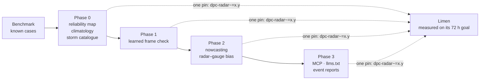

# Roadmap and AI

Where dpc-radar goes next, and how AI and machine learning can make the radar
data better. Nothing here is a promise. Every item has an issue: comment there
before you start. The whole plan is tracked in
[#10](https://github.com/agent-engineering-studio/dpc-radar/issues/10).

dpc-radar is being extracted from
[Limen](https://github.com/agent-engineering-studio/limen), an open
early-warning system for landslides, floods and wildfires in Italy. Limen
uses the DPC radar three ways: as a **trigger** (heavy rain on the radar
starts a run at once), as **rain already fallen** (the «Merging» totals feed
the flood score and the wildfire drought codes), and as **history** (radar
rain from 2010 to 2025 replays past landslides). Every improvement below lands
in this library first, and Limen gets it by updating one pin.

## The goal we measure against

Limen has one goal that decides whether it is useful
([limen#345](https://github.com/agent-engineering-studio/limen/issues/345)):
**anticipate within 72 hours 90 % of the landslides, floods and wildfires
reported in the news, with at most 10 % of municipality-days on alert.** The
two numbers always go together: without the second, it is easy to catch
everything by putting everything on alert.

On 29 October 2026 Limen anticipated **0 of 4** landslides and **0 of 4**
floods. The radar is part of the reason, and of the fix.

## What limits Limen today

| Problem | Where it shows | What the radar has to do with it |
|---|---|---|
| **Alerts were the background, not a forecast** | the four landslides were ≥ Moderate for 64–80 h, but so were ordinary days ([limen#345](https://github.com/agent-engineering-studio/limen/issues/345)) | one national rain threshold cannot work: 50 mm is common in Liguria, exceptional in Apulia |
| **Too few events to measure** | "eight events are an anecdote, not a statistic" | the radar sees every storm, including the ones nobody has verified yet |
| **Corrupted frames** | pixels moving 900–20,584 mm between frames ([limen#235](https://github.com/agent-engineering-studio/limen/issues/235)) | today a fixed rule, `max_step_mm: 150`, throws them away |
| **A blind radar reads as dry** | the cloudburst on Lipari, 10/10/2026, which the radar did not see | Limen cannot tell "no rain" from "no radar here" |
| **The radar arrives late** | Melito, 10/10/2026: forecast 20 mm, radar 152 mm | the radar only shows rain that has already fallen |
| **A biased history** | the radar-only archive read 10–80 % of the gauges in Apulia in 2016 | landslide backtests ([limen#243](https://github.com/agent-engineering-studio/limen/issues/243)) rest on it |

## How we introduce AI

1. **Benchmark first, then models.** A fixed set of cases where we already
   know the answer. Every method passes it before it reaches Limen.
2. **Machine learning on the data, language models only on language.**
   Statistics, gradient boosting and optical flow work on the frames. A
   language model may read news, choose what to compute and explain the
   result in words.
3. **Measured on Limen's goal.** Each item says which number of limen#345
   it should move, and how we check it.

!!! warning "Ground rule for every AI feature"
    Rain values come from DPC frames, read by code that is tested. A
    language model never produces a millimetre, a time or a place itself.
    Every answer names the product and the frame time it came from. Nothing
    this library produces is an official warning: the official one is the
    DPC criticality bulletin, and every AI output links to it.

---

## Phase 0 · now, without touching Limen's code

This phase works on notebooks, data and the benchmark. Limen's radar code
(`grid`, `client`) can move here at any time: Limen is not in operation yet,
so there is no date to wait for.

### Benchmark of known cases · [#2](https://github.com/agent-engineering-studio/dpc-radar/issues/2) · ✅ first version

Ten real cases in [`benchmarks/`](benchmark.md): the Melito storm and the
Lipari miss of 10 October 2026, the corrupted :30 CUM24 series (found on
30/09–02/10, 08–11/10 and 21/10–03/11), the clean frame right after a corrupted
one, two calm days, and two suspect artefacts (a steady 1,000 mm bump, disks
over the sea). Limen's rule today passes **8 of 18** confirmed checks: it has
no frame-level decision, lets the edges of the corrupted bell through (88 mm
where the truth is 9), throws away good pixels after a corrupted frame, and
cannot see steady artefacts or blind spots. Those are the targets of #3 and #6.

### Radar reliability map · [#3](https://github.com/agent-engineering-studio/dpc-radar/issues/3) · effort S

One value per cell: distance from the nearest radar, beam blocking by
mountains, density of rain gauges, and how often radar and «Merging» disagree
there. **For Limen:** where the radar is blind, the forecast weighs more and
radar zero is never "dry". **Check:** Lipari comes out as low reliability.

### Rain climatology · [#4](https://github.com/agent-engineering-studio/dpc-radar/issues/4) · effort M

From the 2010–2025 history, per cell and per window (1, 3, 6, 24 h):
percentiles and a return period from an extreme-value fit.
`climatology.rarity(...)` answers "this rain is a 1-in-N-years event here".
**For Limen:** alert on rain that is unusual *for that place*, not over one
national threshold. This is the largest expected effect on limen#345: fewer
municipality-days on alert, without losing events. **Check:** both numbers
of limen#345, with and without it, on held-out seasons.

### Storm catalogue · [#5](https://github.com/agent-engineering-studio/dpc-radar/issues/5) · effort M

Group SRI cells into storm objects and track them from frame to frame (area,
peak, duration, path). The most extreme storms over inhabited places become
**candidate events**. **For Limen:** the radar says where to look; Limen's
fact-check, which already reads the news with a language model, confirms or
rejects. More verified events, and the storms without damage that a
calibration also needs. **Check:** new verified events per month of archive.

---

## Phase 1 · now that `grid` and `client` are here

### Learned frame check · [#6](https://github.com/agent-engineering-studio/dpc-radar/issues/6) · effort M

**First step done: `jump-sign`** in the [benchmark](benchmark.md). Where two
frames 30 minutes apart differ by more than half an hour of rain, the one that
jumps up is rejected whole. It passes 17 of 18 confirmed checks (Limen today:
8) and, on 96 pairs of whole frames, rejects the 44 corrupted :30 frames and
no :00 frame. What is left for the learned check: artefacts that do not move.

A score per frame and a mask per pixel, from explainable features: the jump
from the frame before (today's rule, kept), symmetry around each radar site,
rain over the sea against the land nearby, agreement between SRI, SRT1 and
«Merging», local outliers. Gradient boosting, trained on frames labelled by
hand, starting from the benchmark. **For Limen:** fewer false triggers, fewer
pixels "not measured" for no reason, one rule for flood, wildfire and the
trigger. **Check:** every quality case of the benchmark passes; calm days stay
clean.

### Foundations: the code that comes from Limen

| Module | What it does | Status |
|---|---|---|
| `products` | the six products, the API requests and answers, `is_expired` | ✅ done |
| `grid` | `RainGrid`: read a frame, sample a point with the **3×3 median**, peak, crop, and `check` against the frame before (`jump-sign`) | ✅ done |
| `client` | `RadarClient.latest(product)`, `.at(product, time)` → a grid or `ABSENT`; injectable `httpx` client, retries, `send=` hook | ✅ done |
| `archive` | `archive()` and `MergingArchive`: save the «Merging» before the DPC deletes it; hourly rain, SRT1 rescaled to CUM3 | ✅ done |
| `history` | `SriHistory`: the IT-DPC-SRI archive (2010–2025) with no zarr or xarray | ✅ done, extra `[history]` |
| `bulletins` | the daily DPC criticality bulletin as data: levels per zone, municipalities, zone at a point | ✅ done, extra `[bulletins]` |

---

## Phase 2 · more lead time, a better history

### Nowcasting 0–2 hours · [#7](https://github.com/agent-engineering-studio/dpc-radar/issues/7) · effort M

The SRI field moved forward along its own motion (optical flow, the method of
[pySTEPS](https://pysteps.github.io/)), then an ensemble for probabilities.
Always labelled as a **forecast**, never mixed with observed rain. A
deep-learning nowcast stays a research notebook. **For Limen:** the trigger
fires on rain that is coming, and the first two hours of the flood window use
it instead of a ~9 km model that does not see thunderstorms. **Check:** CSI at
30, 60, 120 minutes on the storm catalogue, then limen#345.

### Radar–gauge bias model · [#8](https://github.com/agent-engineering-studio/dpc-radar/issues/8) · effort M

Learn how much the radar alone under- or over-estimates («Merging» against the
sum of SRT1), by hour, season, distance from the radar, altitude and
reliability, on Limen's local archive (~51 GB). Apply it every 5 minutes and to
the 2010–2025 history. **For Limen:** credible backtests and a better
climatology. **Check:** error against CUM3 on held-out months, by region.

---

## Phase 3 · AI for people and agents

### MCP server, `llms.txt`, event reports · [#9](https://github.com/agent-engineering-studio/dpc-radar/issues/9) · effort M

- **MCP server** `dpc-radar mcp`, extra `[mcp]`: `latest`, `rain_at(lon, lat, hours)`,
  `area_summary(bbox, hours)`, `storm_now(bbox)`, `rarity(...)`,
  `official_alert(region)`. Someone can ask "how much has it rained on
  Messina today?" and get an answer computed from the frame, with its time.
- **`llms.txt`, `llms-full.txt` and an agent skill**, as in
  [egms-client](https://agentengineering.it/egms-client/): the traps a model
  gets wrong when it writes radar code from memory.
- **Event reports** `dpc-radar report --bbox … --day …`: maps, the hourly
  chart, radar against «Merging», the official bulletin, and a short text
  written from a JSON of computed figures. Every number in the text is checked
  against the JSON before the report is saved.

**For Limen:** the same facts for its assistant and briefings, which run on a
local model (faithfulness eval: 16 of 16 briefings with no invented number),
as structured data instead of prose
([limen#371](https://github.com/agent-engineering-studio/limen/issues/371)).

### In the development loop

| Idea | What | Effort |
|---|---|---|
| **Weekly live test** | a scheduled job that calls the real API and fails when an answer changes shape, like the `origin` header that stopped being required in 2026 | S |
| **Issue on failure** | when the live test fails, an agent opens an issue with the old and new answer side by side | S |
| **Parity test with Limen** | the same frame sampled by Limen and by the library gives the same values on the cells of Melito and the Reggio area | S |

---

## What Limen gains, in one table

| Limen today | With dpc-radar | Issue | Number of limen#345 it should move |
|---|---|---|---|
| one national rain threshold | rain judged against the climate of each cell | #4 | fewer municipality-days on alert |
| 8 verified events | candidate events from the storm catalogue, checked in the news | #5 | a denominator worth measuring |
| radar zero read as dry where the radar is blind | a reliability map | #3 | fewer missed events |
| a fixed 150 mm rule for bad frames | a learned score per frame and pixel | #6 | fewer false alarms |
| a trigger on rain already fallen | a trigger on rain that is coming (0–2 h) | #7 | more events anticipated |
| a radar-only history that under-estimates | a corrected history | #8 | backtests worth trusting |
| facts written into prose | facts as data, for agents and reports | #9 | — |
