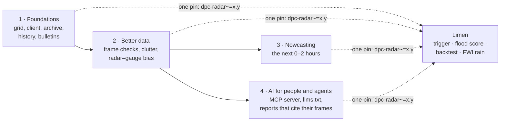

# Roadmap and AI

Where dpc-radar could go next, and how AI can help. Nothing here is a
promise. The point is to pick a direction together: open an issue before you
start one of these.

dpc-radar is being extracted from
[Limen](https://github.com/agent-engineering-studio/limen), an open
early-warning system for landslides, floods and wildfires in Italy. Limen
uses the DPC radar three ways: as a **trigger** (heavy rain on the radar
starts a run at once), as **rain already fallen** (the «Merging» totals feed
the flood score), and as **history** (2010–2025 radar rain replays past
landslides). Every improvement below lands in this library first, and Limen
gets it by updating one pin.

!!! warning "Ground rule for every AI feature"
    Rain values come from DPC frames, read by code that is tested. A
    language model may choose *what* to compute and explain it in words. It
    never produces a millimetre, a time or a place itself. Every answer
    names the product and the frame time it came from. Nothing this library
    produces is an official warning: the official one is the DPC criticality
    bulletin, and every AI output links to it.

---

## 1 · Foundations

This code already runs in Limen. It moves here one pull request at a time,
with its tests.

| Module | What it does | Why it matters | Status |
|---|---|---|---|
| `products` | the six products, the API requests and answers, `is_expired` | the base for everything else | ✅ done |
| `grid` | `RainGrid`: read a frame, sample a point with the **3×3 median**, crop a box, `discard_inconsistent(previous, max_step)` | one hot pixel (Limen once saw 7,348 mm) must never become rain | planned |
| `client` | `RadarClient.latest(product)`, `.at(product, time)` → a grid or `Absent`; injectable `httpx` client and retries | "gone" and "network error" are different answers | planned |
| `archive` | `MergingArchive`: save the «Merging» before the DPC deletes it; `rain_from_radar` splits a 3-hour total into hours using SRT1 | the DPC keeps about five months; the «Merging» has no public archive | planned |
| `history` | read the IT-DPC-SRI archive (2010–2025, radar only) with no zarr or xarray | fifteen years of radar rain for backtests | planned, extra `[history]` |
| `bulletins` | the daily DPC criticality bulletin as data | the official alert, to compare against | to decide, extra `[bulletins]` |

---

## 2 · Better data: machine learning on the frames

These are classic, explainable methods (statistics, gradient boosting,
small convolutional networks). No language model involved. Each one makes
every frame more trustworthy, which is what Limen needs most: **a wrong frame
is either a false alarm or a missed storm.**

| Feature | What it finds or fixes | Method | Gain for Limen | Effort |
|---|---|---|---|---|
| **Learned frame check** | a frame that is not rain: sea clutter, anomalous propagation, a radar with a calibration problem. These often show up as disks centred on one radar site | features per frame (rain around each radar site against its neighbours, change from the frame before, share of the sea that is "raining") → gradient boosting, trained on frames labelled by hand | fewer false nowcast triggers; replaces the fixed `max_step_mm` threshold with a score | M |
| **Hot pixels** | isolated pixels with impossible values | robust spatial statistics (median and MAD of the 5×5 around a pixel), then an isolation forest on the leftovers | no more 7,348 mm cells in the flood score | S |
| **Radar–gauge bias model** | how much the radar alone under- or over-estimates, by hour, season, distance from the radar and altitude | learn the ratio «Merging» / radar on the months where both exist; apply it to SRT1 every 5 minutes and to the 2010–2025 history | the radar-only history (which in Apulia in 2016 read 10–80 % of the gauges) becomes usable for backtests; a «Merging»-like field 25 minutes earlier | M |
| **Quality flag per cell** | how much to trust a value at a place | distance from the nearest radar, beam blocking by mountains, gauge density | Limen can weight observed rain by its quality instead of all-or-nothing | S |
| **Gap filling** | a missing frame in a series | interpolation along the storm's motion (optical flow), clearly marked as filled | an hourly total never silently loses a frame | S |

The data to train and check all of these is already there: Limen's local
archive of «Merging» and SRT1 (about 51 GB), and the rain gauges inside the
«Merging» itself.

---

## 3 · Nowcasting: the next two hours

The radar shows rain *now*. Moving the current rain field forward along its
own motion gives a forecast for the next 0–2 hours that is often better than
any weather model at that range.

| Step | What | Method | Gain for Limen | Effort |
|---|---|---|---|---|
| **Extrapolation** | `nowcast(grids, minutes=60)`: the rain field moved forward along its motion | optical flow (the method of [pySTEPS](https://pysteps.github.io/)), as an optional extra | the trigger fires on rain that is *coming*, not only on rain that is already there | M |
| **Probabilities** | "chance of more than 20 mm in the next hour" per cell | an ensemble of perturbed extrapolations | flood and landslide scores get a probability, not a single number | M |
| **Deep-learning nowcast** | storms that grow or die, which extrapolation cannot see | a U-Net or a generative model trained on the 2010–2025 archive | research first: a notebook, compared against extrapolation on the same storms | L |

Every nowcast is labelled as a **forecast**, with its lead time, and is
never mixed with observed rain.

---

## 4 · AI for people and agents

### 4.1 An MCP server: the radar for any AI assistant

**What.** An optional extra, `dpc-radar[mcp]`, with an
[MCP](https://modelcontextprotocol.io/) server, `dpc-radar mcp`. It serves
the library as tools to Claude, Claude Code, IDE assistants or any other MCP
client:

| Tool | What it returns |
|---|---|
| `latest(product)` | the time and period of the newest frame |
| `rain_at(lon, lat, hours)` | the rain at a point over the last 3, 6, 12 or 24 hours (3×3 median), with the frame time |
| `area_summary(west, south, east, north, hours)` | area covered, mean, percentiles, the wettest cells, the share above 25 / 50 / 100 mm |
| `storm_now(bbox)` | the SRI cells above a threshold, grouped into storms, with their size and peak |
| `official_alert(region)` | the DPC bulletin for today and tomorrow, as published |

**Why.** Someone can ask "how much has it rained on Messina in the last 24
hours?" and get an answer computed from the frame, with its time and source.
It is also the fastest way to spread the library. The same server can give
Limen's assistant its rain facts. Effort: **M**.

### 4.2 `llms.txt` and a skill for coding agents

**What.** Publish `llms.txt` and `llms-full.txt` with this site (as
[egms-client](https://agentengineering.it/egms-client/) already does), and
an agent skill (`SKILL.md`) that tells a coding agent how to use the
library, and above all the traps: no `CUM1`, a 500 that means "gone", the
3×3 median, two grids that must not be mixed.

**Why.** Those traps are exactly what a model gets wrong when it writes
radar code from memory. Effort: **S**.

### 4.3 Event reports that cite their frames

**What.** `dpc-radar report --bbox ... --day 2026-10-10` writes a Markdown or
HTML report: the maps, the hourly chart of the wettest cells, the radar
against the «Merging», the official bulletin of that day, and a short text
that describes them. The text is written from a JSON of computed figures,
and every number in it is checked against that JSON before the report is
saved (a sentence with a number that is not there is removed).

**Why.** Municipalities, journalists and researchers need a readable summary
of an event, and they need it to be right. Limen uses the same reports after
every alert, to say what actually fell. Effort: **M**, after track 1.

### 4.4 AI in the development loop

| Idea | What | Effort |
|---|---|---|
| **Weekly live test** | a scheduled job that calls the real API (as egms-client's `live.yml` does) and fails when an answer changes shape, like the `origin` header that stopped being required in 2026 | S |
| **Issue on failure** | when the live test fails, an agent opens an issue with the old and new answer side by side | S |
| **Parity test with Limen** | the same frame sampled by Limen and by the library must give the same values on the cells of Melito and the Reggio area | S |

---

## What Limen gains, in one table

| Limen today | With dpc-radar | Track |
|---|---|---|
| a fixed threshold to throw away a bad frame | a learned score per frame, the same for every user of the library | 2 |
| radar-only history that under-estimates | a history corrected with a radar–gauge bias model | 2 |
| a trigger on rain that is already there | a trigger on rain that is coming (0–2 h) | 3 |
| summaries written by hand | reports where every number is checked against the frames | 4 |
| its own copy of the DPC client | one library, tested on its own, used by Limen and anyone else | 1 |
